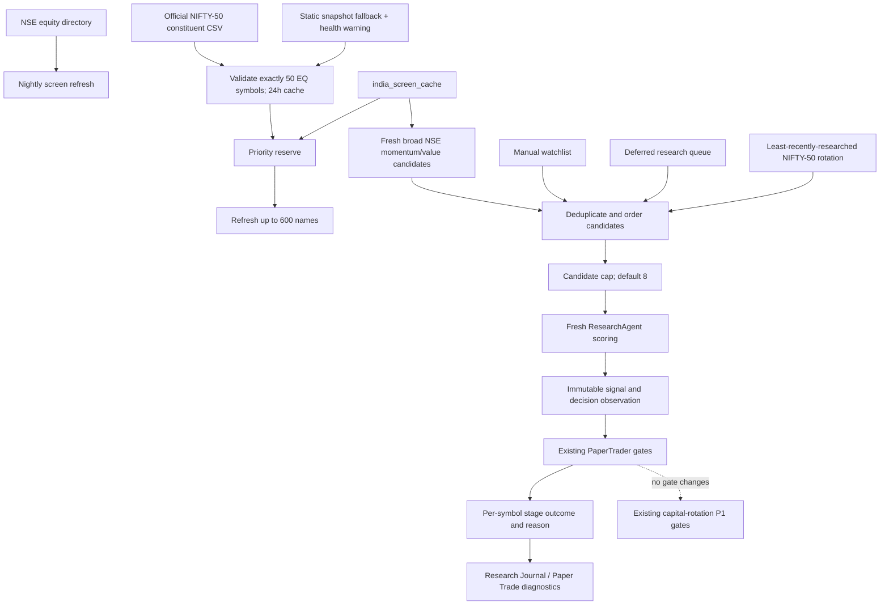

# India Benchmark-Leader Research Coverage

**Status:** Owner-approved implementation; research coverage only
**Date:** 2026-10-16
**Owner request:** diagnose why the India book fell while NIFTY rose, determine whether winners lacked good scores or were never researched, and prevent benchmark leaders from being invisible to the daily candidate funnel.

## Decision

Add a bounded, rotating NIFTY-50 research-coverage lane alongside the existing broad NSE screener. Resolve current constituents from the official NSE Indices CSV (cached for up to 24 hours, accepted only when it parses as exactly 50 unique EQ symbols); if that source cannot be verified, use the repository snapshot and raise a System Health warning. Attempt all in-universe NIFTY-50 screen-cache rows on each nightly refresh, then reserve up to four of the default eight India candidate slots for the least-recently-researched constituents. Explicit manual India watchlist symbols remain first. The remaining slots continue to use deferred, curated-watchlist and broad-screen names.

This adds research coverage only. It does not make an index constituent a buy, change any dimension/composite score, raise a score threshold, alter position sizing, relax liquidity/sector/name/portfolio limits, or enable/force capital rotation. PaperTrader and capital rotation continue to judge the resulting signals using their existing gates.

## Evidence motivating the change

On 2026-10-15 the India portfolio was down approximately 1.26% while NIFTY-50 was up 1.66%. The move was concentrated rather than broad (1,730 decliners vs 881 advancers), led by Tech Mahindra (+4.74%), ICICI Bank (+4.17%) and Reliance (+4.03%). The latest production research signal for those symbols was not from that session; the three `india_screen_cache` rows had last been scored on 2026-08-12. Production cache coverage was 2,455 rows, 600 refreshed in the previous 36 hours and 1,278 in the previous seven days. The cache correctly rotates through a broad NSE universe, but an arbitrary 600-name slice does not guarantee daily freshness for benchmark constituents.

The existing candidate selector only ranks fresh cache rows through two narrow filters (RSI > 60 and above 50-day EMA, or positive ROE and P/E < 35). A valid index leader can be omitted from both buckets. If the cache has no fresh rows it falls back to a fixed prefix of NIFTY-50, which is not a fair rotation. Thus, “score was poor” and “the symbol was not researched” must remain distinguishable.

Coverage was only one part of the miss. ICICI Bank had a valid 69/100 long signal on 2026-10-12 and passed the research threshold, but the paper-trader ledger shows it was denied at the portfolio constructor (book at the 100% gross cap; three Financial Services positions; resulting 0.004% size below the 0.5% minimum), then rejected at execution because the book was already at eight names and had only ₹54.49 cash against an approximately ₹83,072 order. Its rotation diagnostic recorded `score_only_execution_disabled`. Reliance had a 32/100 neutral signal with technical score 0 on the same date, so its later gain does not mean the system had a positive long signal to act on. Tech Mahindra had no fresh research observation in the reviewed window. The new research lane addresses missing/stale coverage; it cannot itself create portfolio capacity or turn an ineligible/blocked signal into a trade.

## Data and decision flow

### Nightly screen refresh

`fetchNifty50Constituents` reads the official NSE Indices CSV and accepts only a complete, unique set of 50 EQ symbols. It caches the parsed list for 24 hours. On a failed fetch or schema/coverage check, both the nightly refresh and ResearchAgent use the repository snapshot and raise the same market-local warning; the warning resolves after a verified official list returns. `orderUniverseForRefresh` puts current constituents first and sorts by staleness within that set. `buildIndiaRefreshSlice` guarantees those names remain in the 50-name reserve even if the Upstox prefilter excludes them from the broad-universe remainder. The reserve is part of the existing 600-name budget, not an additional provider-call budget. Members absent from the NSE directory are not attempted.

### Daily research candidate lane

ResearchAgent orders held positions separately, as before. For new India candidates it preserves manual watchlist precedence, reserves up to half of the configured candidate cap (four of the default eight) for NIFTY-50 symbols ordered by oldest latest `agent_signals.created_at`, then fills from the existing deferred, curated and fresh broad-screen pools. The reserve is bounded by both the candidate cap and available index names. Duplicates are normalized to Yahoo `.NS` symbols and removed.

The selector deliberately does not select only names that already satisfy the final buy threshold. Its purpose is to observe the benchmark universe so later score/return analysis can tell whether the scoring model failed, the symbol lacked an eligible signal, or a portfolio/execution gate prevented entry.

### Per-symbol decision reasons

The existing `pipeline_stage_events` ledger records symbol, market, stage, outcome, reason and structured detail for attempted trades. The Research Journal route returns those rows for each observation; PaperTrader already logs liquidity, quote, sizing, constructor, rotation and execution decisions. This feature reuses that ledger and does not create a duplicate skip table. Symbols not yet selected for a research run remain in the existing `research_queue` overflow/carry-forward mechanism; queue overflow is a research-capacity delay, not a trade rejection.

If the broad screen cache has no fresh rows or its read fails, ResearchAgent emits/resolves a market-local warning and continues the bounded NIFTY-50 coverage lane. It does not silently present a failed broad screen as a healthy complete universe. The live constituent source is independent from the historical static snapshot used by breadth/replay features; historical membership is not rewritten with today's constituents.

## Boundaries and safety

- India remains NSE-only; BSE is explicitly out of scope.
- No paid provider or new API is introduced.
- No schema migration is required; existing `NIFTY_50` snapshot, `india_screen_cache`, `agent_signals`, `research_queue`, and `pipeline_stage_events` are reused. The only added data fetch is the official free constituent CSV.
- The broad 2,000+ NSE screener remains a rotating, partially fresh universe. This feature does not claim every NSE symbol is scored daily.
- Benchmark membership is research coverage, not an endorsement or eligibility bypass.
- No change to cash targets, 8-name cap, sector/name exposure, liquidity, score-to-return evidence, stop/target, or capital-rotation execution.

## Acceptance tests

1. Current official NIFTY-50 symbols are ordered ahead of the broad refresh slice, staleness-ordered within the priority set, without duplicates; the 50-member reserve remains in the refresh slice when the Upstox filter excludes those symbols.
2. Candidate order keeps manual names first, places the configured NIFTY reserve next, then deferred/watchlist/screener names, normalizes NSE suffixes, and deduplicates.
3. Failed/empty fresh cache reads create a warning while the NIFTY lane still proceeds; a later successful read resolves that warning.
4. No entry, sizing, exit or rotation gate is changed by the new discovery lane.
5. Production verification after deployment must show (a) the next screen-refresh run rescored the NIFTY-50 set or records per-symbol provider skips and (b) the next India research runs contain rotating NIFTY names with contemporaneous observations. Do not claim rally capture or benchmark improvement from coverage alone.

## Files

- `lib/india-universe.ts` — pure candidate ordering and refresh-priority helpers.
- `lib/nifty50-constituents.ts` — isolated official constituent CSV parsing/fetch; deliberately separate from NSE insider-data adapters.
- `lib/research-agent.ts` — reserve and rotate index candidates, surface broad-cache failure.
- `app/api/scan/india/refresh/route.ts` — priority ordering inside the existing refresh capacity.
- `tests/india-refresh-order.test.ts`, `tests/nifty50-constituents.test.ts` — deterministic ordering and CSV-validation tests.
- `docs/arch/03-agents.md` — operational architecture entry.
